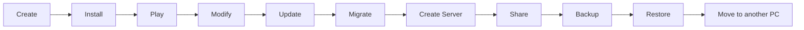

<p align="center">
  <b>English</b> · <a href="README_RU.md">Русский</a>
</p>

<p align="center">
  
</p>

<p align="center">
  <b>A modern Minecraft workspace and launcher based on PineconeMC.</b>
</p>

<p align="center">
  Modern UX · Powerful instances · Smart migration · Servers · Sharing
</p>

> [!IMPORTANT]
> **PXL Cone is currently in early development / pre-alpha.**
> There are no public builds yet. Most PXL-specific features described below are planned and are not implemented yet.

---

## What is PXL Cone?

PXL Cone is an open-source Minecraft launcher project built on **PineconeMC** and, through it, the Prism Launcher ecosystem.

The goal is not to replace a mature launcher core with a new one from scratch.

The goal is to keep the power of Prism/Pinecone while making everyday Minecraft management easier, more visual and more connected.

> **Simple by default, powerful when needed.**

---

## The idea: Minecraft as a workspace

PXL Cone is planned around the whole lifecycle of a Minecraft setup, not just the launch button.



A workspace may connect:

```text
Instance
├── Content
├── Worlds
├── Server
├── Snapshots
├── History
├── Variants
└── Sharing
```

---

## Planned highlights

### 🧭 Modern everyday UX

PXL Cone aims for a cleaner, more direct interface without removing advanced controls.

Planned ideas include:

- recent worlds, instances and servers on the home screen;
- direct world launch;
- `Content → Browse → Install` without unnecessary dialogs;
- source-neutral content browsing;
- clear background tasks and downloads;
- native C++ / Qt instead of Electron.

The standard **Cone** theme is intended to feel calm and native: useful cards, restrained animation, clear hierarchy, no giant glowing buttons or generic web-dashboard look.

---

### 🔄 Smart Migration

Changing Minecraft version or loader should not mean rebuilding a pack by hand.

Example:

```text
Minecraft 1.20.1 + Forge
→
Minecraft 1.21.1 + Fabric
```

PXL Cone is planned to analyze installed content and classify it:

```text
READY
UPDATE
ALTERNATIVE
MANUAL
UNAVAILABLE
UNKNOWN
CONFIG RISK
```

Before anything changes, the user sees a migration preview.

Alternative projects should never be substituted silently.

---

### 🕓 Snapshots and history

Risky changes should be reversible.

Before actions such as:

- changing Minecraft version;
- changing loader;
- updating many mods;
- applying a migration;
- modifying a linked server;

PXL Cone can create a restore point.

Example history:

```text
Today 18:42
Migrated 1.20.1 → 1.21.1

Today 17:10
Updated 12 mods

Yesterday
Installed Create
```

Think of it as **Git-like history for Minecraft**, without requiring the player to know Git.

---

### 🤝 Pack Collaboration

Two players should be able to work on one modpack without sending `mods.zip` back and forth.

Internally the model can use ideas similar to branches, commits and merges.

The normal UI should use Minecraft-friendly language instead:

| Internal idea | Player-facing wording |
| ------------- | --------------------- |
| Branch        | Pack variant          |
| Commit        | Save changes          |
| Merge         | Combine changes       |
| Conflict      | Need to choose        |
| Pull          | Get changes           |
| Push          | Send changes          |
| Diff          | Changes               |

Example conflict:

```text
You both changed the same setting.

Render distance

Your version:
16 chunks

Alex's version:
24 chunks

[Keep your version]
[Keep Alex's version]
[Choose another value]
```

The collaboration system is intended to support **direct peer-to-peer synchronization** without requiring PXL-owned storage servers.

GitHub integration may be offered later as an optional advanced backend.

---

### 🖥️ Local server workflows

PXL Cone is planned to treat local Minecraft servers as first-class workspace objects.

Possible flow:

```text
Instance
→ Create Server
→ detect loader/version
→ separate client-only content
→ copy compatible configs/world
→ create linked server
```

A server can then be managed from the launcher:

```text
Overview
Mods / Plugins
Players
World
Backups
Console
Logs
Settings
```

The launcher is not planned as a hosting provider. Internet exposure, VPS hosting or tunneling can remain separate.

---

### 📦 Sharing and transfer

PXL Cone plans to support multiple formats instead of locking users into one launcher.

#### `.pxlconep`

A richer **PXL Cone workspace / project format**.

It may include:

- Minecraft and loader metadata;
- mod/content metadata;
- client ↔ server relationship;
- optional or recommended content;
- world metadata;
- workspace-specific settings.

#### `.pxlt`

A transfer format for moving your own environment:

```text
Windows → Linux
old PC → new PC
desktop → laptop
```

It may include selected instances, worlds, configs, screenshots, launcher organization and local servers.

#### Standard formats

PXL Cone also plans first-class interoperability with:

- Modrinth `.mrpack`;
- supported CurseForge formats;
- normal offline ZIP exports.

Conversion between `.mrpack` and `.pxlconep` is planned where practical, with clear warnings when Cone-specific metadata would be lost.

---

### 🎨 Themes

PXL Cone is planned to ship with more than a simple color switch.

#### Cone

The normal modern interface.

#### Terminal

A real alternative presentation with:

- monospaced typography;
- terminal-like layouts;
- keyboard-first navigation;
- ASCII-style elements;
- restrained dark visuals.

Example:

```text
> workspace: create-survival
> minecraft: 1.21.1
> loader: fabric
> status: ready

[ RUN ]
```

Community themes are planned as **data-only packages** so a visual theme does not automatically gain arbitrary code execution.

---

### 🧩 Modules

PXL Cone may become a large launcher, but every user should not need every feature.

Planned module controls:

```text
✓ Library
✓ Discover
✓ Worlds
✓ Servers
✓ Snapshots
✓ Migration
✓ Pack Collaboration
□ Developer Tools
□ Advanced Console
□ Experimental Features
```

Modules should be enableable or disableable without restarting the launcher where technically practical.

Future community modules may use a stable permission-based API and could eventually be distributed through a built-in catalog.

---

<details>
<summary><b>Advanced users: what stays from Prism / Pinecone?</b></summary>

PXL Cone is not intended to remove advanced launcher functionality.

The project is built on a mature upstream foundation that already provides functionality such as:

- isolated Minecraft instances;
- Microsoft account support;
- Ely.by support inherited from PineconeMC;
- Fabric / Forge / NeoForge / Quilt support where available upstream;
- Modrinth and CurseForge integration;
- Java/runtime handling;
- instance import/export;
- mature Minecraft launch logic.

The intention is to keep core launch and authentication behavior close to upstream whenever possible.

</details>

---

## Platforms

Initial focus:

```text
Windows
Linux
```

Planned packaging may include:

```text
Windows x64 Installer
Windows Portable ZIP

RPM
DEB
pkg.tar.zst
Flatpak
AppImage
```

macOS may be considered later after the Windows/Linux version is stable.

---

## Roadmap

This is a direction, not a release promise.

- [x] Create PineconeMC fork
- [x] Initial PXL Cone branding
- [x] Product and UX specifications
- [ ] First PXL-specific UI prototype
- [ ] Modern Library / Content workflow
- [ ] Workspace foundation
- [ ] Snapshots and history
- [ ] Smart Migration
- [ ] Local server workflows
- [ ] Pack Collaboration
- [ ] Theme system
- [ ] Module system
- [ ] Public alpha

---

## Performance philosophy

PXL Cone should stay lightweight, but performance claims will only be used after benchmarking.

Design goals:

```text
Fast startup
Low idle CPU usage
No always-running embedded Chromium
Asynchronous downloads
Cached artwork
No unnecessary network work at startup
No UI freezes during long operations
```

---

## Development

PXL Cone is currently in **early development / pre-alpha**.

There is no public release date yet.

> [!NOTE]
> Ideas, UX feedback and feature discussion are welcome in GitHub Discussions.
> Bug reports for features that do not exist yet are not useful.

---

## Open source

PXL Cone is based on GPL-licensed upstream software and is distributed under **GPL-3.0** where applicable.

The launcher should remain useful without requiring a PXL account.

Optional integrations may exist later, but the core launcher is intended to remain usable without them.

---

## Disclaimer

PXL Cone Launcher is an independent community project.

It is not an official product of, sponsored by, or endorsed by Mojang Studios, Microsoft, Prism Launcher, PineconeMC, Modrinth, CurseForge or Ely.by.

Minecraft is a trademark of Microsoft / Mojang Studios.

---

## Follow development

- ⭐ Star the repository if you want to bookmark the project.
- 👀 Watch the repository for development activity.
- 💬 Use GitHub Discussions for ideas and UX feedback.

No public build is available yet.
