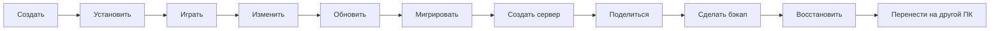

<p align="center">
  <a href="README.md">English</a> · <b>Русский</b>
</p>

<p align="center">
  
</p>

<p align="center">
  <b>Современный Minecraft Workspace и лаунчер на базе PineconeMC.</b>
</p>

<p align="center">
  Современный UX · Мощные инстансы · Умная миграция · Серверы · Обмен
</p>

> [!IMPORTANT]
> **PXL Cone сейчас находится на ранней стадии разработки / pre-alpha.**
> Публичных сборок пока нет. Большинство PXL-функций, описанных ниже, запланированы и ещё не реализованы.

---

## Что такое PXL Cone?

PXL Cone — это open-source проект Minecraft-лаунчера на базе **PineconeMC** и, через него, экосистемы Prism Launcher.

Цель проекта не в том, чтобы переписывать с нуля уже зрелое ядро лаунчера.

Цель — сохранить мощность Prism/Pinecone, но сделать повседневное управление Minecraft проще, нагляднее и связнее.

> **Просто по умолчанию, мощно когда нужно.**

---

## Идея: Minecraft как Workspace

PXL Cone планируется вокруг всего жизненного цикла Minecraft-сборки, а не только вокруг кнопки запуска.



Workspace может объединять:

```text
Инстанс
├── Контент
├── Миры
├── Сервер
├── Снимки
├── История
├── Варианты
└── Обмен
```

---

## Основные запланированные возможности

### 🧭 Современный повседневный UX

PXL Cone стремится к более чистому и прямому интерфейсу без удаления продвинутых настроек.

Планируются:

- недавние миры, инстансы и серверы на главном экране;
- прямой запуск мира;
- `Контент → Обзор → Установить` без лишних диалогов;
- поиск контента без привязки к одному источнику;
- понятные фоновые задачи и загрузки;
- нативный C++ / Qt вместо Electron.

Стандартная тема **Cone** должна ощущаться спокойной и нативной: полезные карточки, сдержанные анимации, понятная иерархия, без огромных светящихся кнопок и ощущения типичного web-dashboard.

---

### 🔄 Умная миграция

Смена версии Minecraft или загрузчика не должна означать ручную пересборку всего модпака.

Пример:

```text
Minecraft 1.20.1 + Forge
→
Minecraft 1.21.1 + Fabric
```

PXL Cone планируется так, чтобы анализировать установленный контент и распределять его по категориям:

```text
ГОТОВО
ОБНОВЛЕНИЕ
АЛЬТЕРНАТИВА
ВРУЧНУЮ
НЕДОСТУПНО
НЕИЗВЕСТНО
РИСК КОНФИГА
```

Перед применением изменений пользователь должен увидеть полный предварительный отчёт.

Альтернативные проекты не должны подставляться молча.

---

### 🕓 Снимки и история

Рискованные изменения должны быть обратимыми.

Перед такими действиями, как:

- смена версии Minecraft;
- смена загрузчика;
- массовое обновление модов;
- применение миграции;
- изменение связанного сервера;

PXL Cone сможет создавать точку восстановления.

Пример истории:

```text
Сегодня 18:42
Миграция 1.20.1 → 1.21.1

Сегодня 17:10
Обновлено 12 модов

Вчера
Установлен Create
```

Это можно воспринимать как **Git-подобную историю для Minecraft**, но без необходимости знать Git.

---

### 🤝 Совместная работа над сборками

Два игрока должны иметь возможность работать над одной сборкой без постоянной пересылки `mods.zip`.

Внутри система может использовать идеи веток, коммитов и merge.

Но обычный интерфейс должен использовать понятные Minecraft-термины:

| Внутренняя идея | Формулировка для игрока |
| --------------- | ----------------------- |
| Branch          | Вариант сборки          |
| Commit          | Сохранить изменения     |
| Merge           | Объединить изменения    |
| Conflict        | Нужно выбрать           |
| Pull            | Получить изменения      |
| Push            | Отправить изменения     |
| Diff            | Изменения               |

Пример конфликта:

```text
Вы оба изменили одну настройку.

Дальность прорисовки

Ваш вариант:
16 чанков

Вариант Alex:
24 чанка

[Оставить ваш вариант]
[Оставить вариант Alex]
[Выбрать другое значение]
```

Система совместной работы планируется с поддержкой **прямой peer-to-peer синхронизации**, без обязательного хранения сборок на серверах PXL.

GitHub позже может быть добавлен как дополнительный backend для продвинутых пользователей.

---

### 🖥️ Работа с локальными серверами

PXL Cone должен относиться к локальным Minecraft-серверам как к полноценной части Workspace.

Возможный сценарий:

```text
Инстанс
→ Создать сервер
→ определить загрузчик и версию
→ отделить client-only контент
→ перенести совместимые конфиги / мир
→ создать связанный сервер
```

После этого сервер можно будет управлять прямо из лаунчера:

```text
Обзор
Моды / Плагины
Игроки
Мир
Бэкапы
Консоль
Логи
Настройки
```

PXL Cone не планируется как хостинг-провайдер. Доступ из интернета, VPS или туннели могут оставаться отдельными решениями.

---

### 📦 Обмен и перенос

PXL Cone планирует поддерживать несколько форматов вместо привязки к одному лаунчеру.

#### `.pxlconep`

Более богатый формат **PXL Cone Workspace / Project**.

Он может включать:

- метаданные Minecraft и загрузчика;
- метаданные модов и другого контента;
- связь клиент ↔ сервер;
- необязательный или рекомендуемый контент;
- метаданные мира;
- настройки Workspace, специфичные для Cone.

#### `.pxlt`

Формат переноса собственного окружения:

```text
Windows → Linux
старый ПК → новый ПК
стационарный ПК → ноутбук
```

Он может включать выбранные инстансы, миры, конфиги, скриншоты, организацию лаунчера и локальные серверы.

#### Стандартные форматы

PXL Cone также планирует полноценную совместимость с:

- Modrinth `.mrpack`;
- поддерживаемыми форматами CurseForge;
- обычными offline ZIP-архивами.

Где это возможно, планируется конвертация между `.mrpack` и `.pxlconep` с понятным предупреждением, если при экспорте потеряются данные, специфичные для Cone.

---

### 🎨 Темы

PXL Cone планируется не просто с переключателем цвета.

#### Cone

Обычный современный интерфейс.

#### Terminal

Настоящее альтернативное представление:

- моноширинный шрифт;
- terminal-like компоновка;
- навигация с клавиатуры;
- ASCII-элементы;
- сдержанный тёмный визуал.

Пример:

```text
> workspace: create-survival
> minecraft: 1.21.1
> loader: fabric
> status: ready

[ RUN ]
```

Пользовательские темы планируются как **data-only пакеты**, чтобы визуальная тема сама по себе не получала возможность выполнять произвольный код.

---

### 🧩 Модули

PXL Cone может стать большим лаунчером, но каждому пользователю не нужны все функции сразу.

Планируется система модулей:

```text
✓ Библиотека
✓ Discover
✓ Миры
✓ Серверы
✓ Снимки
✓ Миграция
✓ Совместная работа
□ Инструменты разработчика
□ Расширенная консоль
□ Экспериментальные функции
```

Там, где это технически возможно, модули должны включаться и отключаться без перезапуска лаунчера.

В будущем пользовательские модули могут использовать стабильный API с системой разрешений и распространяться через встроенный каталог.

---

<details>
<summary><b>Для продвинутых пользователей: что остаётся от Prism / Pinecone?</b></summary>

PXL Cone не планирует удалять продвинутые возможности лаунчера.

Проект строится на зрелой upstream-базе, которая уже предоставляет такие возможности, как:

- изолированные Minecraft-инстансы;
- поддержка Microsoft-аккаунтов;
- поддержка Ely.by, унаследованная от PineconeMC;
- Fabric / Forge / NeoForge / Quilt там, где они поддерживаются upstream;
- интеграция Modrinth и CurseForge;
- управление Java/runtime;
- импорт и экспорт инстансов;
- зрелая логика запуска Minecraft.

Планируется по возможности сохранять core launch и authentication-логику близко к upstream.

</details>

---

## Платформы

Основной первоначальный фокус:

```text
Windows
Linux
```

Планируемые варианты распространения:

```text
Windows x64 Installer
Windows Portable ZIP

RPM
DEB
pkg.tar.zst
Flatpak
AppImage
```

macOS может рассматриваться позже, после стабилизации Windows/Linux-версии.

---

## Roadmap

Это направление разработки, а не обещание конкретных сроков.

- [x] Создан fork PineconeMC
- [x] Добавлен первоначальный брендинг PXL Cone
- [x] Подготовлены продуктовые и UX-спецификации
- [ ] Первый PXL-специфичный UI-прототип
- [ ] Современные Library / Content-сценарии
- [ ] Основа Workspace
- [ ] Снимки и история
- [ ] Smart Migration
- [ ] Работа с локальными серверами
- [ ] Совместная работа над сборками
- [ ] Система тем
- [ ] Система модулей
- [ ] Публичная alpha

---

## Подход к производительности

PXL Cone должен оставаться лёгким, но заявления о производительности будут использоваться только после реальных бенчмарков.

Цели:

```text
Быстрый запуск
Низкая нагрузка на CPU в простое
Без постоянно работающего встроенного Chromium
Асинхронные загрузки
Кэширование изображений
Без лишних сетевых запросов при запуске
Без зависаний UI во время долгих операций
```

---

## Разработка

PXL Cone сейчас находится на стадии **early development / pre-alpha**.

Публичной даты релиза пока нет.

> [!NOTE]
> Идеи, отзывы по UX и обсуждение функций приветствуются в GitHub Discussions.
> Баг-репорты на функции, которых ещё не существует, пока не имеют смысла.

---

## Open source

PXL Cone основан на GPL-лицензированном upstream-коде и распространяется под **GPL-3.0** там, где это применимо.

Для базового использования лаунчера не должен требоваться PXL-аккаунт.

В будущем могут появиться дополнительные интеграции, но основное ядро лаунчера должно оставаться пригодным для использования без них.

---

## Отказ от аффилиации

PXL Cone Launcher — независимый проект сообщества.

Он не является официальным продуктом Mojang Studios, Microsoft, Prism Launcher, PineconeMC, Modrinth, CurseForge или Ely.by и не спонсируется и не одобряется ими.

Minecraft является товарным знаком Microsoft / Mojang Studios.

---

## Следить за разработкой

- ⭐ Поставьте Star репозиторию, если хотите сохранить проект.
- 👀 Используйте Watch, чтобы следить за активностью разработки.
- 💬 Используйте GitHub Discussions для идей и отзывов по UX.

Публичных сборок пока нет.
